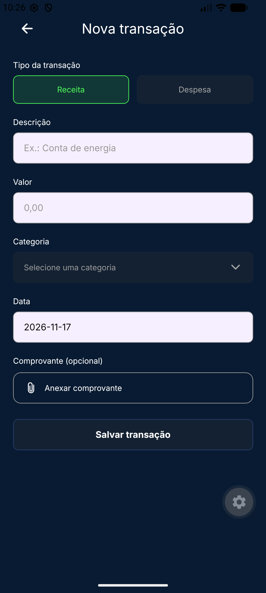
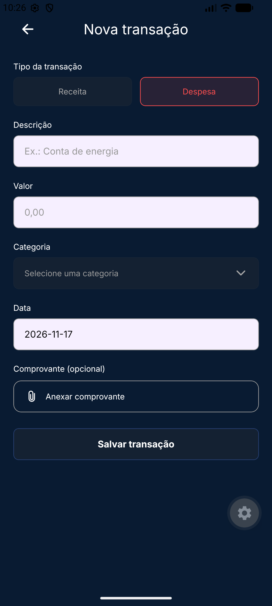

# FIAP Finance Mobile

Aplicativo de gerenciamento financeiro desenvolvido em React Native como parte do Tech Challenge da Pós-Tech FIAP.

O sistema permite autenticar usuários, gerenciar receitas e despesas, consultar análises financeiras e armazenar transações e comprovantes na nuvem por meio do Firebase.

## Funcionalidades

### Autenticação e usuário
- Cadastro com nome, telefone, e-mail e senha
- Login com e-mail e senha
- Autenticação pelo Firebase Authentication
- Persistência da sessão com criptografia
- Logout seguro
- Proteção das rotas privadas com guards
- Autenticação biométrica (FaceID/TouchID) opcional
- Perfil do usuário armazenado no Cloud Firestore
- Separação dos dados por UID

### Dashboard
- Saudação personalizada
- Saldo calculado automaticamente
- Total de receitas e despesas
- Opção de ocultar e exibir valores
- Três transações mais recentes
- Estado vazio e acesso ao extrato completo
- Animações de entrada com suporte a redução de movimento

### Transações
- Cadastro de receitas e despesas com descrição, valor, categoria e data
- Validação com Zod
- Edição e exclusão com confirmação
- Persistência no Cloud Firestore com atualização em tempo real
- Isolamento das transações por usuário autenticado
- Otimistic updates para UX responsiva

### Comprovantes
- Anexo opcional (JPEG, PNG, PDF até 5 MB)
- Upload para o Firebase Storage
- Visualização, troca e remoção do arquivo
- Exclusão automática ao excluir a transação
- Regras de segurança por UID

### Extrato
- Listagem com busca por descrição
- Filtros por tipo, categoria e data (combináveis)
- Paginação infinita (lazy loading)
- Acesso à edição de cada transação
- Estados de carregamento e lista vazia

### Análise financeira
- Saldo total, receitas e despesas
- Gráfico de receitas e despesas
- Visualização mensal e por categoria
- Atualização automática após alterações

### Navegação
Menu lateral com acesso a: Início, Extrato, Análise financeira, Nova transação, Logout

## Tecnologias

### Core
- **Expo SDK 57** - Framework React Native
- **React 19** - UI Library
- **React Native 0.86** - Mobile Framework
- **Expo Router** - File-based routing
- **TypeScript 6** - Type safety

### State Management
- **Zustand 4** - Global state (auth, UI, transactions)
- **TanStack Query (React Query) 5** - Server state, caching, background refetch

### Firebase
- **Firebase Authentication** - Auth com persistência criptografada
- **Cloud Firestore** - Banco de dados NoSQL em tempo real
- **Firebase Storage** - Armazenamento de comprovantes

### Forms & Validation
- **React Hook Form 7** - Form management
- **Zod 4** - Schema validation
- **@hookform/resolvers** - Zod integration

### UI & Animations
- **React Native Reanimated 4** - Animations
- **React Native Gesture Handler** - Gestures
- **React Native SVG** - SVG support
- **Ionicons / Expo Vector Icons** - Icons

### Security
- **Expo Local Authentication** - Biometric auth (FaceID/TouchID)
- **Expo Crypto** - Cryptographic utilities
- **AsyncStorage 2** - Encrypted local storage

### File Handling
- **Expo Document Picker** - File selection

### Development & Testing
- **Jest 29** - Test runner
- **Jest Expo** - Expo test preset
- **React Native Testing Library** - Component testing
- **ESLint 9** - Linting
- **TypeScript** - Static analysis

## Arquitetura - Clean Architecture

O projeto segue os princípios da **Clean Architecture** com separação clara de responsabilidades:

```
src/
├── domain/                          # Regras de Negócio da Empresa (TypeScript Puro)
│   ├── entities/                    # Entidades de negócio principais
│   │   ├── Transaction.ts
│   │   ├── User.ts
│   │   └── Receipt.ts
│   ├── repositories/                # Interfaces de repositórios (Ports)
│   │   ├── ITransactionRepository.ts
│   │   ├── IUserRepository.ts
│   │   ├── IAuthRepository.ts
│   │   └── IReceiptRepository.ts
│   ├── use-cases/                   # Regras de Negócio da Aplicação
│   │   ├── transactions/
│   │   │   ├── GetTransactionsUseCase.ts
│   │   │   ├── CreateTransactionUseCase.ts
│   │   │   ├── UpdateTransactionUseCase.ts
│   │   │   └── DeleteTransactionUseCase.ts
│   │   ├── auth/
│   │   │   ├── LoginUseCase.ts
│   │   │   ├── RegisterUseCase.ts
│   │   │   ├── LogoutUseCase.ts
│   │   │   ├── GetCurrentUserUseCase.ts
│   │   │   └── SubscribeToAuthChangesUseCase.ts
│   │   └── receipts/
│   │       ├── UploadReceiptUseCase.ts
│   │       └── DeleteReceiptUseCase.ts
│   └── services/                    # Serviços de domínio
│       ├── FinancialCalculator.ts
│       └── TransactionValidator.ts
│
├── data/                            # Adaptadores de Interface / Frameworks
│   ├── repositories/                # Implementações de repositórios
│   │   ├── TransactionRepositoryImpl.ts
│   │   ├── UserRepositoryImpl.ts
│   │   ├── AuthRepositoryImpl.ts
│   │   └── ReceiptRepositoryImpl.ts
│   ├── datasources/                 # Fontes de dados
│   │   ├── firebase/
│   │   │   ├── FirebaseTransactionDataSource.ts
│   │   │   ├── FirebaseAuthDataSource.ts
│   │   │   ├── FirebaseUserDataSource.ts
│   │   │   └── FirebaseReceiptDataSource.ts
│   │   └── local/
│   │       ├── SecureStorage.ts
│   │       └── CacheStorage.ts
│   ├── mappers/                     # Mappers Data ↔ Domain
│   │   ├── TransactionMapper.ts
│   │   ├── UserMapper.ts
│   │   └── ReceiptMapper.ts
│   └── cache/                       # Cache React Query
│       ├── queryClient.ts
│       └── queryKeys.ts
│
├── presentation/                    # Camada de UI
│   ├── components/                  # Componentes UI reutilizáveis
│   │   ├── common/
│   │   ├── forms/
│   │   ├── charts/
│   │   ├── navigation/
│   │   └── transactions/
│   ├── hooks/                       # Custom React hooks
│   │   ├── useTransactions.ts
│   │   ├── useAuth.ts
│   │   ├── useReceipts.ts
│   │   └── useFinancialSummary.ts
│   ├── store/                       # Zustand stores
│   │   ├── authStore.ts
│   │   ├── transactionStore.ts
│   │   └── uiStore.ts
│   └── styles/                      # Tokens de tema
│       ├── colors.ts
│       └── typography.ts
│
├── infrastructure/                  # Configurações de framework
│   ├── firebase/
│   │   └── config.ts
│   ├── navigation/
│   │   ├── routes.ts
│   │   └── guards.ts
│   └── security/
│       ├── encryption.ts
│       ├── biometric.ts
│       └── tokenManager.ts
│
└── app/                             # Entry points Expo Router
    ├── _layout.tsx
    ├── providers.tsx
    ├── root-content.tsx
    ├── index.tsx
    ├── (auth)/
    │   ├── _layout.tsx
    │   ├── login.tsx
    │   ├── cadastro.tsx
    │   └── boas-vindas.tsx
    └── (private)/
        ├── _layout.tsx
        ├── dashboard.tsx
        ├── extrato.tsx
        ├── analise.tsx
        └── transacao/
            ├── [id].tsx
            └── nova.tsx
```

### Camadas da Arquitetura

| Camada | Responsabilidade | Tecnologias |
|--------|------------------|-------------|
| **Domain** | Regras de negócio puras, entidades, interfaces | TypeScript puro, Zod |
| **Data** | Implementações de repositórios, data sources, cache | Firebase, AsyncStorage, TanStack Query |
| **Presentation** | UI, hooks, estado global | React, Zustand, React Query |
| **Infrastructure** | Configurações de framework | Firebase, Expo, Navigation |

### Benefícios da Clean Architecture
- ✅ **Testabilidade** - Use cases são TypeScript puro, facilmente testáveis
- ✅ **Independência de Framework** - Domain não conhece React, Firebase, etc.
- ✅ **Inversão de Dependência** - Repositórios dependem de interfaces
- ✅ **Manutenibilidade** - Separação clara de responsabilidades
- ✅ **Escalabilidade** - Fácil adição de novas features

## Rotas

| Rota | Descrição | Acesso |
|---|---|---|
| `/login` | Login do usuário | Público |
| `/cadastro` | Cadastro do usuário | Público |
| `/boas-vindas` | Boas-vindas após o cadastro | Autenticado |
| `/dashboard` | Resumo financeiro | Privado |
| `/extrato` | Listagem, busca e filtros | Privado |
| `/analise` | Indicadores e gráfico | Privado |
| `/transacao/nova` | Cadastro de transação | Privado |
| `/transacao/[id]` | Edição e exclusão | Privado |

## Como executar

### Pré-requisitos
- Node.js 20 LTS ou superior
- npm
- Expo Go, emulador Android/iOS ou navegador
- Projeto configurado no Firebase

### 1. Clonar o repositório
```bash
git clone URL_DO_REPOSITORIO
```

### 2. Entrar na pasta
```bash
cd fiap-finance-mobile
```

### 3. Instalar as dependências
```bash
npm install --legacy-peer-deps
```

### 4. Configurar as variáveis de ambiente
Crie um arquivo `.env` na raiz do projeto com base no `.env.example`:
```env
EXPO_PUBLIC_FIREBASE_API_KEY=
EXPO_PUBLIC_FIREBASE_AUTH_DOMAIN=
EXPO_PUBLIC_FIREBASE_PROJECT_ID=
EXPO_PUBLIC_FIREBASE_STORAGE_BUCKET=
EXPO_PUBLIC_FIREBASE_MESSAGING_SENDER_ID=
EXPO_PUBLIC_FIREBASE_APP_ID=
```
Os valores estão disponíveis no Firebase Console → Configurações do projeto → Geral → Seus aplicativos → Configuração do SDK.

O arquivo `.env` não deve ser enviado ao GitHub.

### 5. Iniciar o projeto
```bash
npm start
# ou
npx expo start
```
No Windows: `npx.cmd expo start`

### Executar no Android
```bash
npm run android
```

### Executar no iOS
```bash
npm run ios
```

### Executar no navegador
```bash
npm run web
```

## Configuração do Firebase

### Authentication
No Firebase Console:
1. Abra `Authentication`
2. Entre em `Método de login`
3. Ative o provedor `E-mail/senha`

### Cloud Firestore
Estrutura utilizada:
```
users
└── UID
    ├── name
    ├── phone
    ├── email
    ├── createdAt
    ├── updatedAt
    └── transactions
        └── transactionId
            ├── description
            ├── value
            ├── operation
            ├── category
            ├── date
            ├── type
            ├── receiptUrl
            ├── createdAt
            └── updatedAt
```

Regras do Firestore:
```
rules_version = '2';
service cloud.firestore {
  match /databases/{database}/documents {
    match /users/{userId} {
      allow read, create, update, delete:
        if request.auth != null && request.auth.uid == userId;
      match /transactions/{transactionId} {
        allow read, create, update, delete:
          if request.auth != null && request.auth.uid == userId;
      }
    }
  }
}
```

### Firebase Storage
O Firebase Storage exige que o projeto esteja no plano Blaze (pode permanecer nas cotas gratuitas).

Estrutura:
```
users
└── UID
    └── receipts
        └── arquivo
```

Regras do Storage:
```
rules_version = '2';
service firebase.storage {
  match /b/{bucket}/o {
    match /users/{userId}/receipts/{fileName} {
      allow read, delete:
        if request.auth != null && request.auth.uid == userId;
      allow create, update:
        if request.auth != null
        && request.auth.uid == userId
        && request.resource.size < 5 * 1024 * 1024
        && (request.resource.contentType.matches('image/.*') || request.resource.contentType == 'application/pdf');
    }
  }
}
```

## Validação das transações
O formulário utiliza Zod para validar:
- Descrição entre 3 e 80 caracteres
- Valor obrigatório e maior que zero
- Operação do tipo receita ou despesa
- Categoria válida
- Data válida

Categorias: Alimentação, Casa, Educação, Lazer, Saúde, Salário, Transporte, Transferência, Outros

## Segurança
- Rotas privadas exigem autenticação (AuthGuard)
- Cada documento associado ao UID do usuário
- Regras do Firestore e Storage restringem acesso ao proprietário
- Somente imagens e PDFs de até 5 MB
- **Criptografia AES-GCM** para tokens e credenciais sensíveis
- **Armazenamento seguro** com AsyncStorage criptografado
- **Autenticação biométrica** opcional (FaceID/TouchID)
- **Gerenciamento de tokens** com expiração e refresh automático
- `.env` protegido pelo `.gitignore`

## Performance e Otimização

### Cache Inteligente (TanStack Query)
- **Stale Time**: 5 minutos
- **Cache Time**: 30 minutos
- **Background Refetch**: Automático ao reconectar
- **Cache Local**: 2 minutos (CacheStorage com TTL)

### Lazy Loading
- Code splitting por rota (Expo Router)
- Paginação infinita no extrato (blocos de 10)
- Prefetch de dados relacionados

### Otimizações React
- `useMemo` / `useCallback` para cálculos derivados
- `React.memo` em componentes puros
- Virtualização de listas grandes (pronto para implementar)
- Imagens otimizadas com Expo Image

### Programação Reativa
- TanStack Query para estado do servidor reativo
- Zustand para estado global reativo com seletores
- Firestore listeners para tempo real

## Testes automatizados
Os testes verificam:
- **Resumo financeiro**: Soma de receitas/despesas, cálculo do saldo, saldo negativo, lista vazia
- **Validação**: Transação válida, descrição curta, valor zerado/não numérico, operação/categoria/data inválidas, formato brasileiro

### Executar os testes
```bash
npm test
npm test -- --runInBand  # sem paralelismo
npm run test:watch       # modo contínuo
npm run test:coverage    # cobertura
```

## Verificação de qualidade
```bash
# TypeScript
npx tsc --noEmit
# Windows: npx.cmd tsc --noEmit

# ESLint
npm run lint
# Windows: npm.cmd run lint

# Verificação completa
npm run lint && npx tsc --noEmit && npm test -- --runInBand
```

## Decisões técnicas

### Clean Architecture + Context API (Legacy)
Implementa **Clean Architecture** completa nas novas camadas (`domain`, `data`, `presentation`, `infrastructure`), mantendo o `UserContext` como adaptador para compatibilidade com componentes existentes no layout privado.

### Estado Global (Zustand + TanStack Query)
- **Zustand**: Estado UI global (auth status, modais, tema, menu lateral)
- **TanStack Query**: Estado do servidor (transações, usuário, comprovantes) com cache inteligente

### Segurança em Camadas
1. **Domain**: Validação Zod na borda
2. **Data**: Repositórios com regras de acesso
3. **Infrastructure**: Criptografia, biometria, token manager
4. **Firebase**: Regras de segurança no backend

## Acessibilidade
- Labels em botões e controles interativos
- Funções semânticas para botões e links
- Estados selecionados nos filtros
- Cores centralizadas no tema
- Suporte à configuração de redução de movimento
- Áreas de toque ampliadas em controles importantes

## Melhorias futuras
- Aplicar máscara automática ao telefone
- Aprimorar a máscara monetária
- Ampliar a cobertura dos testes de componentes
- Gerar builds nativas para Android e iOS
- Implementar virtualização de listas (FlashList)
- Adicionar sincronização offline-first
- Implementar notificações push

## Capturas de Tela

### Autenticação
| Login |
|-------|
|  |

### Dashboard
| Dashboard Principal | Menu Lateral |
|---------------------|--------------|
|  |  |

### Transações
| Nova Transação | Extrato com Filtros |
|----------------|---------------------|
|  |  |

### Análise Financeira
| Visão Mensal |
|--------------|
|  |

---

Projeto desenvolvido para o Tech Challenge da Pós-Tech FIAP.